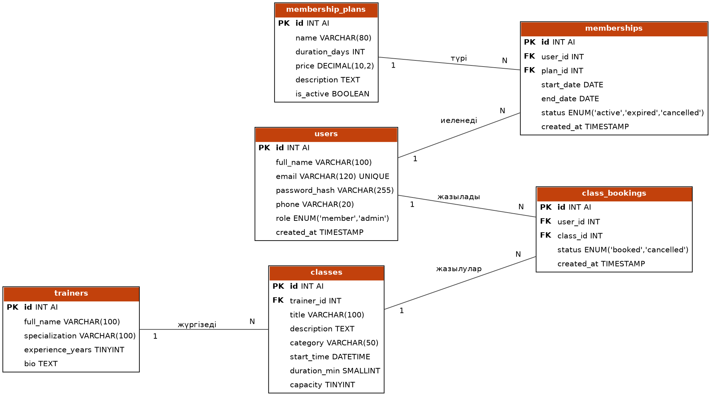

# Fit Club

Фитнес-клубқа арналған веб-қосымша (PHP + MySQL). Мүшелер абонемент алып, жаттығулар кестесін көріп, жаттығуларға онлайн жазыла алады. Әкімші абонемент түрлерін, жаттықтырушыларды және жаттығулар кестесін басқарады.

> **Жоба күйі:** 8-апта: жоспарлау кезеңі.

## Жобаның мақсаты

Фитнес-клубтағы абонемент сату мен жаттығуларға жазылу процесін онлайн, ашық әрі ыңғайлы етіп ұйымдастыру.

## Шешілетін мәселелер

- Абонемент түрлері мен бағалары туралы ақпаратты бір жерден көру.
- Жаттығулар кестесін көріп, бос орын бар-жоғын алдын ала білу.
- Қағаз журналсыз, онлайн жазылу және бас тарту.
- Әкімшіге мүшелер мен кестені басқарудың бір құралы.

## Пайдаланушы рөлдері

| Рөл | Мүмкіндіктері |
|-----|---------------|
| Қонақ | Басты бет, абонементтер мен жаттықтырушыларды көру, тіркелу, кіру |
| Мүше | Абонемент алу, жаттығуларды іздеу, жазылу және бас тарту, профиль |
| Әкімші | Абонементтер, жаттықтырушылар, жаттығулар, мүшелерді басқару |

## Негізгі мүмкіндіктер

- Тіркелу, кіру және шығу (сессиялар, `password_hash`)
- Абонемент таңдау және оның мерзімін бақылау
- Жаттығулар кестесін іздеу, сүзу (категория, жаттықтырушы, күн), сұрыптау және пагинация
- Жаттығуға жазылу (бос орын мен абонемент тексеріледі) және бас тарту
- Әкімші панелі: CRUD операциялары
- Деректерді валидациялау және қауіпсіздік шаралары

## Технологиялар

- **Backend:** PHP 8, PDO
- **Дерекқор:** MySQL
- **Frontend:** HTML5, CSS3, JavaScript
- **Орта:** XAMPP, DBeaver
- **Нұсқаларды басқару:** Git / GitHub
- **Хостинг:** InfinityFree (жоспарланған)

## Беттер тізімі

Толық тізім: [docs/pages.md](docs/pages.md)

| Бет | Файл |
|-----|------|
| Басты бет | `index.php` |
| Тіркелу / Кіру / Шығу | `register.php` / `login.php` / `logout.php` |
| Абонементтер | `plans.php` |
| Менің абонементім | `my_membership.php` |
| Жаттықтырушылар | `trainers.php` |
| Жаттығулар кестесі | `classes.php` |
| Менің жаттығуларым | `my_classes.php` |
| Профиль | `profile.php` |
| Админ панелі | `admin/index.php` және басқару беттері |

## Дерекқор құрылымы (ER-диаграмма)



| Кесте | Сипаттамасы |
|-------|-------------|
| `users` | Пайдаланушылар (мүшелер мен әкімшілер) |
| `membership_plans` | Абонемент түрлері |
| `memberships` | Мүшелердің сатып алған абонементтері |
| `trainers` | Жаттықтырушылар |
| `classes` | Жаттығулар кестесі |
| `class_bookings` | Жаттығуларға жазылулар |

**Байланыстар (1:N):** `users`→`memberships`, `membership_plans`→`memberships`, `trainers`→`classes`, `users`→`class_bookings`, `classes`→`class_bookings`.

SQL-скрипт: [database/schema.sql](database/schema.sql)

## Жоба құрылымы

```
fit-club/
├── admin/            # әкімші беттері
├── assets/           # css, js, суреттер
├── includes/         # db.php, auth.php, header.php, footer.php
├── database/         # schema.sql
├── docs/             # ER-диаграмма, беттер тізімі
├── index.php
├── login.php
├── register.php
├── plans.php
├── classes.php
└── README.md
```

## Жергілікті іске қосу

1. XAMPP-та Apache мен MySQL-ді қосыңыз.
2. Жоба қалтасын `htdocs/fit-club` ішіне салыңыз.
3. `database/schema.sql` файлын DBeaver немесе phpMyAdmin арқылы орындаңыз.
4. Браузерде `http://localhost/fit-club/` ашыңыз.

## Даму жоспары

| Апта | Тақырып | Күйі |
|------|---------|------|
| 8 | Жоспарлау және репозиторий құру | Орындалды |
| 9 | Frontend (HTML, CSS, JS) | Жоспарда |
| 10 | PHP негіздері, include, формалар | Жоспарда |
| 11 | MySQL, тіркелу, кіру, сессиялар | Жоспарда |
| 12 | CRUD операциялары | Жоспарда |
| 13 | Іздеу, сүзу, сұрыптау, пагинация | Жоспарда |
| 14 | Қосымша функциялар және қауіпсіздік | Жоспарда |
| 15 | Тестілеу, хостинг, қорғау | Жоспарда |

## Автор

*Қонысбай Аяжан Сайфуллақызы*

*Байланыс номері: +77077198531*

*Почта: konysbayaiazhan@gmail.com*
